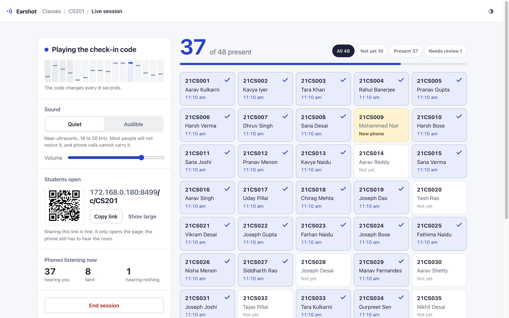
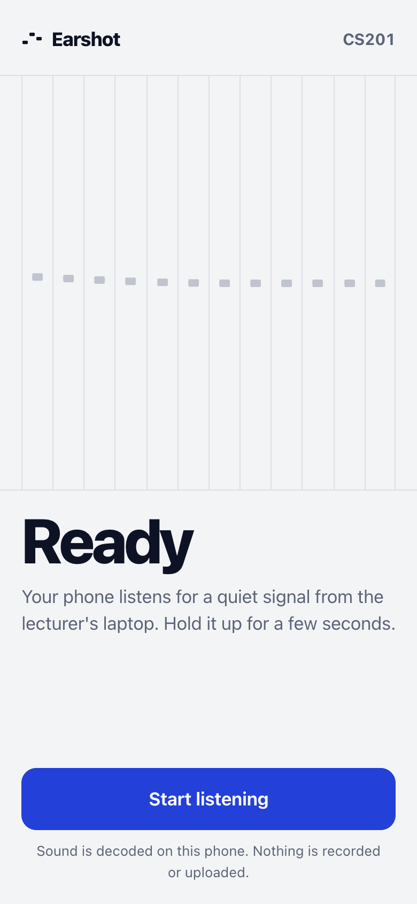
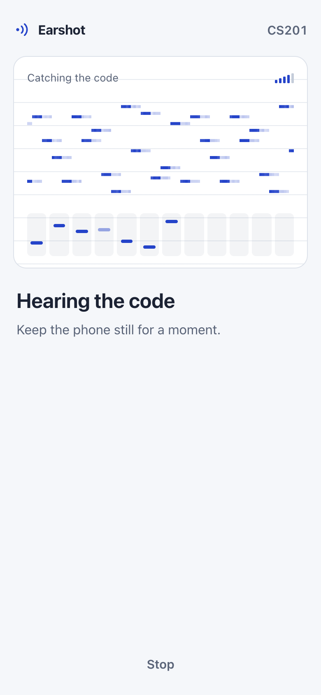
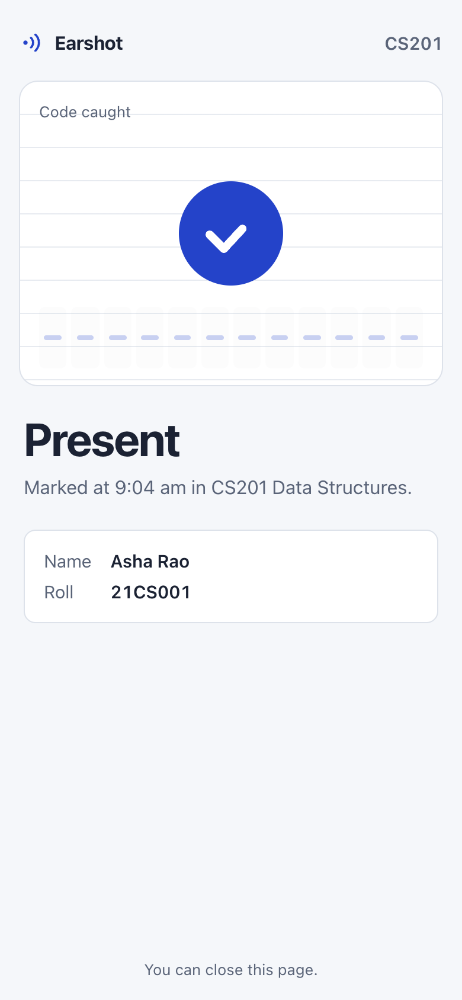
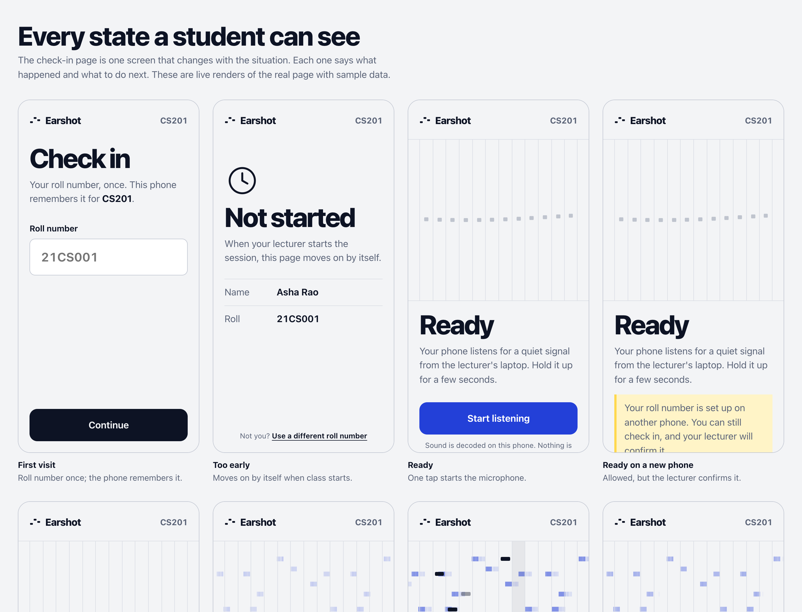
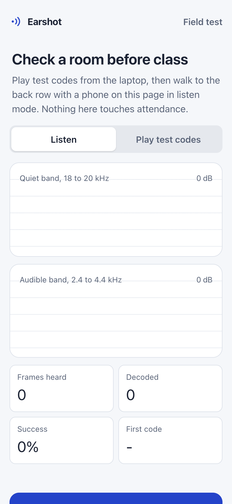

# Earshot

Attendance that needs you in the room. The lecturer's laptop plays a short code as sound, mostly above what people notice. Students open a link and hold their phone up. If the phone hears the current code, they are marked present. If they are at home, there is nothing to hear.



<!-- Demo GIF: record a phone checking in during a real lecture and save it as docs/demo.gif -->
> **Demo GIF placeholder.** Add a 10 second recording of a phone checking in here (`docs/demo.gif`).

## The problem

In many Indian colleges attendance decides whether you can sit the exam, so it gets gamed. Friends sign for each other. A QR code on the projector gets photographed and lands in the class WhatsApp group within seconds. Roll call is the reliable option, and it costs 5 to 10 minutes of every lecture.

Anything a student can **see** can be copied and forwarded. Sound in a room is different: it fades with distance, it does not pass through a phone call intact, and it changes every few seconds. Earshot uses that.

## How it feels

**Lecturer.** Open the dashboard, tap **Start session** on the class. The laptop starts playing the code and a register of the class list appears. Names ink in as students check in. Tap **End session** and download a CSV.

**Student.** Open the class link once (it never changes, so it can sit in the WhatsApp group description). Enter a roll number the first time. Tap **Start listening**, hold the phone up for a few seconds, and see a confirmation with the time.

Nobody installs anything. It is a web page.

| Listening | Catching the code | Present |
| --- | --- | --- |
|  |  |  |

The listening view draws what the phone actually hears: a scrolling spectrogram of the tone band, where the code shows up as a staircase of tones. Below it, 12 slots fill in as each symbol is caught, each mark at the pitch it was heard at. When the code is complete, the marks line up and turn into the check.

Every situation has its own screen with a plain next step: no microphone permission, the wrong (non-https) link, a faint signal, nothing heard, a new phone, a phone that already checked someone in, a session that ended, no connection. They are all on one page at `/states`.



## How the sound works

I wrote the modem rather than using ggwave or Quiet.js. ggwave is the closest fit, but it needs a WebAssembly build. Owning the protocol also made two things possible that matter here: combining repeated frames to reach the back row, and drawing the code in the UI symbol by symbol.

**Tones.** 16-ary frequency shift keying. Each 100 ms symbol is one tone out of 16, with 12 ms raised-cosine ramps so an 18 kHz tone does not click.

**Two bands, heard at once.**

| Band | Range | Use |
| --- | --- | --- |
| Quiet | 18.0 to 19.9 kHz | Default. Most adults do not notice it, and phone-call codecs drop it. |
| Audible | 2.4 to 4.4 kHz | Fallback for big rooms or weak speakers. Sounds like soft chirps. |

The phone always listens to both, so students never choose a mode. The lecturer can switch with one tap.

**Echo handling.** The 32 tones in a band are split into two interleaved banks. Even symbols use bank A and odd symbols use bank B. Room echo from one symbol lands in the bank that is not being read next, so it does not compete.

**Frame.** 16 symbols, 1.6 seconds:

```
| sync x4 | counter (8 bits) | HMAC tag (24 bits) | Reed-Solomon parity x4 |
|  fixed  |       2 nibbles  |       6 nibbles    |        4 nibbles       |
```

The parity is RS(12, 8) over GF(16). It could correct 2 wrong symbols, but that would accept about 23% of random noise as valid, so it corrects 1 (about 0.3% false acceptance) and leaves the rest to repetition.

**Rotation and repetition.** The code changes every 8 seconds and each code is played 5 times. If a frame fails the parity check, the phone adds its soft values to the previous one or two repeats and tries again. That is what makes weak signals usable: in simulation it decodes reliably down to -6 dB signal-to-noise inside the band.

**Decoder.** An AudioWorklet hands raw microphone samples to the page. Every 25 ms, Goertzel filters measure all 64 tones over a 75 ms window, each relative to its own noise floor. That is about 10 million multiply-adds a second, which is light for a cheap Android phone. Browser voice processing (echo cancellation, noise suppression, auto gain) is turned off because it removes exactly these tones.

**Lecturer side.** The laptop computes each code locally with WebCrypto and schedules frames on the Web Audio clock 3 seconds ahead, aligned to the server's windows. A short Wi-Fi drop does not stop the sound.

## How it resists cheating

The goal is proportionate defence for a college, not a bank. Each attack below is something a student would actually try.

| Attempt | What stops it | What is left |
| --- | --- | --- |
| Forward the link or the QR code | The link only opens the page. Presence comes from the sound. | Nothing. Sharing the link is encouraged. |
| Record the sound, play it later | Codes rotate every 8 s. The server accepts the current window and one either side, so a code is useful for 24 s at most. | A replay inside that window works (see the next row). |
| Send a voice note or relay it over a call | WhatsApp, phone calls and most VoIP use speech codecs that cut everything above about 8 kHz. The quiet band does not survive. | Audible mode does pass through calls. The dashboard says so, and check-ins in audible mode are marked. A high-fidelity music stream (48 kHz, no processing) could carry the quiet band, but someone in the room has to stream it live for each absent friend. |
| Type or share the code | There is no code entry. The code is never shown. | A technical student could decode in class and relay it to a script within 24 s. That needs a modified client and still runs into the phone checks below. |
| Forge requests to the server | Codes are HMAC-SHA256 with a per-session secret only the server and lecturer laptop know. Guessing is limited to 8 tries per phone per minute against a 24-bit tag. | Effectively nothing. |
| One phone checks in several people | Each phone makes an ECDSA P-256 key pair whose private key cannot be exported from the browser. Every request is signed. A phone can check in one person per session and is tied to one roll number per class. | |
| Use a friend's roll number on your own phone | A roll number is tied to the first phone that uses it. Any other phone is accepted but held as **Needs review** in the lecturer's register. | The lecturer decides. Approving makes it the student's phone from then on. |
| Clear browser data or use incognito to look like a new phone | A new key is a new phone, so the same review rule applies. | |
| Claim someone else's roll number before they do | The first phone wins. When the real student checks in, their phone is flagged as new and the lecturer sees it. The lecturer can unlink a phone from the class page. | A proper fix is college sign-in (v2). |
| Check in, then leave | Not covered. | Random re-checks during the lecture (v2). |

**Trade-offs I chose:**

- **Flag, don't block.** Phones break and batteries die. A new phone, or a check-in in audible mode, is recorded and marked for the lecturer rather than refused. The lecturer can also mark anyone present by hand. A system that wrongly marks honest students absent loses trust faster than one that lets the odd edge case through.
- **No location, no Wi-Fi checks.** GPS is unreliable indoors and invasive. Campus Wi-Fi addresses are shared by hundreds of students and change with mobile data. The sound is a better proximity signal than either.
- **No accounts in the MVP.** Roll number plus a device key is enough for a pilot. College single sign-on is the first thing to add for real use.
- **Audio never leaves the phone.** Decoding happens in the browser. The server sees only the decoded 32-bit code.

## What works where

Browsers only give pages the microphone over **https**. On `localhost` that is automatic. For phones on the same Wi-Fi, run `npm run cert` to make a self-signed certificate, then tap through the browser warning once. `npm run live` gives a trusted https link through a tunnel instead (see [Test with two devices](#test-with-two-devices)). Behind any other proxy, set `EARSHOT_PUBLIC_URL` so the dashboard shows the right link, and `EARSHOT_TRUST_PROXY=1` so rate limits use the forwarded address.

| | Expected | Notes |
| --- | --- | --- |
| Chrome on Android | Yes | AudioWorklet, and voice processing can be turned off. |
| Safari on iPhone (14.5+) | Yes | The page starts audio inside the tap, as iOS requires. |
| Laptop speakers | Quiet band at short to medium range | Many laptop speakers roll off above 18 kHz. Audible mode and the room's speakers extend range. |
| Back of a large lecture hall | Use audible mode or the room PA | The field test page (`/lab`) shows what each seat hears. |

## Run it

Needs Node 22.13 or newer. There are no dependencies to install.

```sh
git clone <this repo> earshot && cd earshot
npm run seed       # optional: three demo classes with past sessions
npm run cert       # optional: https for phones on the same Wi-Fi (needs openssl)
npm start
```

The terminal prints a lecturer link with a key (`http://localhost:8080/?key=...`) and the student address for your Wi-Fi. Data lives in `data/earshot.db` (SQLite, through `node:sqlite`).

To see the live register fill without a room full of phones, start a session for CS201 and run:

```sh
node scripts/simulate-class.js CS201 40 30   # 40 phones over 30 seconds
```

### Test with two devices

`npm run live` starts the server and opens a [Cloudflare quick tunnel](https://developers.cloudflare.com/cloudflare-one/connections/connect-networks/do-more-with-tunnels/trycloudflare/) (needs `cloudflared`; no account). It prints a public `https://….trycloudflare.com` address with a trusted certificate, so any laptop or phone on any network can open it and use the microphone with no warnings. Without `cloudflared` it falls back to `localhost.run` over ssh. The address changes on every run.

1. **Laptop A (lecturer)** runs `npm run seed` once, then `npm run live`, and opens the `localhost` lecturer link it prints.
2. **Check the signal first.** On A, open `/lab` and choose **Play test codes**. On B, open the public `/lab` link and choose **Listen**. Decoded codes appear in the log within a few seconds. Try both bands and different distances.
3. **Run a session.** On A, start a session for **PH110** (its class list is open, so any roll number works). On B, open `<public address>/c/PH110`, enter a roll number and name, and tap **Start listening**. B's name appears in A's register.
4. **Try to cheat.** Open the same link in a second browser on B and check in as someone else (it is a new phone, so it lands in **Needs review**). Check in a second person from the same browser (refused). Play a recording of the sound 30 seconds later (refused). Put A on speaker over a WhatsApp call to B (the quiet band does not get through).

On the same Wi-Fi without a tunnel, `npm run cert` and `npm start` work too, but phones show a certificate warning first, and many college networks block devices from reaching each other.

### Before a real class

1. Open `/lab` on the laptop and choose **Play test codes**.
2. Open `/lab` on a phone, walk to the back row, choose **Listen**.
3. If the quiet band struggles there, turn the laptop volume up, plug into the room speakers, or plan to use audible mode.



## Tests

```sh
npm test       # 24 tests: Reed-Solomon, QR, modem through a simulated room, API and attack cases
npm run bench  # catch rate vs noise and echo, both bands
npm run e2e    # real browser check-in (see below)
```

`npm run e2e` is the closest thing to a real phone without one. It creates a class and a session, renders the session's actual upcoming codes to a WAV file through the simulated room (echo, roll-off, noise at 3 dB SNR), and gives that file to Chrome as its microphone. The real student page then has to identify, listen, decode and check in. It passes for both bands, and for the quiet band at -3 dB, typically in 4 to 6 seconds. Chrome's fake microphone delivers silence when headless, so this test opens a Chrome window parked off-screen.

Simulated results for the full sweep are in [docs/modem-bench.md](docs/modem-bench.md). In short: 100% of codes caught down to -6 dB in-band SNR at reverb times from 0.4 to 1.2 s, for both bands, with no false decodes in any run.

## Project layout

```
server/
  index.js          http and https servers, startup message
  app.js            routes: lecturer API, student API, check-in rules
  codes.js          rotating HMAC codes and window checks
  devices.js        device key thumbprints and signature checks
  db.js             SQLite schema and queries
  events.js         server-sent events for the live register
  ratelimit.js
public/
  js/modem/         the sound protocol, shared by browser and tests
    protocol.js     bands, frame layout, payload packing
    synth.js        payload to samples
    demod.js        samples to payload: Goertzel, sync, soft combining
    rs.js, gf16.js  Reed-Solomon RS(12, 8) over GF(16)
  js/lecturer/      dashboard and transmitter
  js/lib/           receiver, device identity, clock sync, QR encoder, listening view
  js/student.js     the check-in page and its states
  lab.html          field test
  states.html       every student state
scripts/            seed, class simulator, benchmark, e2e, screenshots, cert
test/               node:test suites and the simulated room
```

**Data model.** `courses` have `students` (roll, name, bound device). `sessions` belong to a course and hold the code secret. `checkins` join a session and a student, with the device, time, status (`present` or `pending`), method (`sound` or `manual`) and flags. `attempts` logs rejected tries. `devices` stores public keys.

## Known limitations

- **Not yet tested on physical phones or in a real lecture hall.** Everything above is from unit tests, the simulated room, and real Chrome fed with recorded audio. The first real-room session should start with the field test page.
- **Some people can hear 18 kHz,** especially younger listeners, as a faint high hiss. The default volume is moderate and audible mode exists for when the quiet band is a problem either way.
- **Some phones and laptops filter high frequencies.** Cheap laptop speakers often fall off above 18 kHz, and a few Android microphones roll off above 16 kHz. Audible mode covers both.
- **iOS may apply its own audio processing** whatever the page asks for. If that removes the quiet band on some iPhones, audible mode is the fallback.
- **The lecturer key is a single shared secret** printed at startup. Fine for one lecturer on a laptop, not for a department.
- **Self-signed https shows a warning** on phones the first time. A tunnel or a real certificate avoids it.
- **One server process.** Rate limits and live listener counts are in memory.

## Ideas for v2

- College single sign-on instead of roll number plus device key.
- Random re-checks during the lecture, a few seconds of listening, to catch check-in-and-leave.
- Two-way proof: the phone answers with its own short chirp that the laptop must hear. This would close the live-relay gap.
- Timing checks: compare when the phone heard a frame with when the laptop played it, and flag relays that add latency.
- A projector view that shows only the count and the QR, without names.
- Per-room calibration that picks volume and band from a 20 second field test.
- Department dashboards: attendance trends and students at risk of falling below the required percentage.
- Run the decoder in a Web Worker on very slow phones.

## License

MIT. See [LICENSE](LICENSE).
